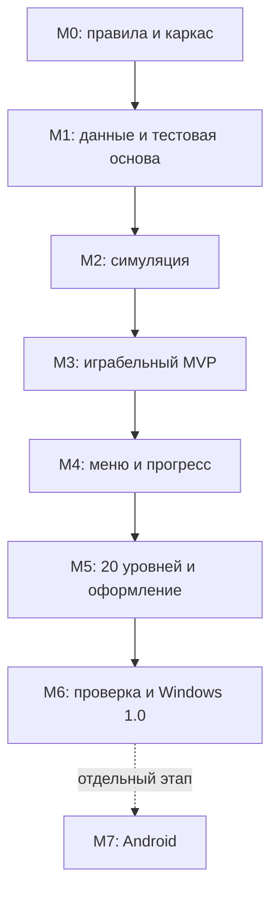

# Дорожная карта

Версия 1.0, 14.10.2026. Статус: разработка ещё не начата.
Правила и API: [ARCHITECTURE.md](ARCHITECTURE.md). Исполнимые задачи: [TASKS.md](TASKS.md). Порядок работы Codex: [AGENTS.md](AGENTS.md).

## 1. Результаты разработки

1. **Прототип правил:** без оформления, но с проверяемой симуляцией, победой и настоящим тупиком.
2. **Играбельный MVP:** пять уровней, полный цикл выбора коробок и доставки, пауза, рестарт, понятные победа и поражение.
3. **Версия 1.0 для Windows:** 20 проверенных уровней, обучение, меню, настройки, сохранения, оформление, звук и запускаемая сборка.
4. **Отдельное продолжение:** Android после принятой Windows-версии. Не входит в критерии завершения 1.0.

Основной маршрут последовательный: сначала зафиксировать правила, затем проверить модель, затем связывать её с интерфейсом. Не начинать полный набор уровней, пока правила и игровая сессия меняются.

## 2. Зависимости этапов

Сбор исходных наблюдений и собственных художественных набросков возможен раньше. Контент 20 уровней, оптимизации и мобильный экспорт не должны задерживать доказательство работоспособности основного цикла.

## 3. Этапы и контрольные точки

### M0. Правила и каркас — T01–T03

Вход: четыре документа плана и установленный Godot 4.5.1.

Работа: сверить доступные наблюдения о референсе; сохранить различия и допущения; создать project.godot, основную сцену, структуру проекта и команду проверки импорта. Подготовить базовую сетку портретного экрана и файл исключений Git.

Выход: проект открывается и запускается, документация соответствует выбранному ruleset. Если точная механика оригинала остаётся неизвестной, A01–A06 остаются явно отмеченными решениями нашей версии, а этап продолжается.

Условие перехода: нет ошибок импорта/парсинга, проверенный путь к движку, выбранная версия правил записана. На этом этапе игра ещё не обязана быть играбельной.

### M1. Данные и тестовая основа — T04–T07

Зависит от M0.

Работа: тестовый runner, типы данных и схемы, загрузчик, validator, минимальные положительные и отрицательные fixtures. Сначала fail-fast проверка контента, затем создание модели.

Выход: корректный уровень загружается, повреждённые данные дают конкретную ошибку поля; автоматические проверки имеют честный exit code и число выполненных тестов.

Условие перехода: проверены размеры, ссылки, граф зависимостей, баланс квот, schema/ruleset и ошибки manifest. Равенство цветов ещё не считается доказательством решения.

### M2. Детерминированная симуляция — T08–T13

Зависит от M1.

Работа: доступность и пути, очередь команд, запас, слоты, резервирование, доставка, завершение партии, инварианты, воспроизведение решений.

Выход: в headless режиме можно пройти собственный уровень, воспроизвести тупик и проверить решения через production Simulation.

Условие перехода: тест 5×2 из архитектуры выигрывается правильным порядком и проигрывается неправильным; два одинаковых прогона имеют одинаковые события; занятые слоты с текущими рейсами не вызывают ранний проигрыш. Все тесты домена проходят.

**Контрольная точка «прототип правил».** Если игра не даёт интересного выбора, менять локализованные правила сейчас, с новой записью ADR и обновлением fixtures. Не маскировать проблему анимацией и большим количеством уровней.

### M3. Играбельный MVP — T14–T19

Зависит от M2.

Работа: GameSession, отображение поля/коробок/слотов, ввод, рейсы муравьёв, HUD, пауза, рестарт, результат, пять уровней с решениями.

Выход: игру можно пройти с мышью от начала до победы, проиграть, перезапустить и перейти к следующему уровню. Графика пока простая, но цвет, квота и состояние каждого слота понятны.

Условие перехода: пять уровней прошли автоматическую проверку и ручное прохождение; пауза не меняет модель; рестарт в середине рейса не оставляет старые события; результат не зависит от частоты отрисовки при том же журнале команд.

**Контрольная точка «MVP».** Это рабочая игра для оценки ощущений. Сохранения и release-экспорт ещё не являются условием этого этапа.

### M4. Меню, прогресс и настройки — T20–T23

Зависит от M3.

Работа: устойчивое сохранение, главное меню, выбор уровней, настройки громкости/анимации/символов, обучение на первых уровнях, понятные ошибки.

Выход: после закрытия и повторного запуска сохраняются прогресс и настройки; открываются только положенные уровни; отсутствующий или повреждённый save не ломает запуск.

Условие перехода: проверены первая загрузка, победа, повторная загрузка, резервная копия, сбой записи, будущая версия save; обучение не блокирует допустимый ход и не создаёт вторую систему правил.

### M5. Контент и оформление — T24–T27

Зависит от M4.

Работа: довести кампанию до 20 уровней, настроить рост сложности, добавить собственную графику и звук, завершить адаптивную компоновку, символы цветов и reduced_motion.

Выход: визуально цельная кампания без заглушек в основном пользовательском пути; каждый уровень имеет проверенное решение.

Условие перехода: все 20 уровней валидны и решаются; в каталоге нет невидимых/недоступных коробок из-за раскладки; звуковые эффекты не перегружают микшер; маленькое и широкое окно остаются играбельными.

### M6. Проверка и выпуск Windows 1.0 — T28–T31

Зависит от M5.

Работа: полная регрессия, нагрузочная сцена и измерения, необходимые оптимизации, Windows export preset, проверка включения контента в экспорт, запуск сборки отдельно от редактора, инструкция запуска.

Выход: `builds/windows/AntPicture.exe` с необходимыми сопутствующими файлами, инструкция и фактический отчёт проверки. Build output не хранить в Git по умолчанию.

Условие завершения 1.0:

- Кампания из 20 уровней проверена автоматически и вручную.
- Победа, проигрыш, пауза, рестарт и повторный вход работают без ошибок.
- Настройки и прогресс переживают перезапуск, проверено восстановление из backup.
- Пройдены целевые размеры окна, ввод мышью и проверка отсутствия двойной обработки.
- Нет известных блокирующих дефектов: зависания партии, неверного исхода, потери прогресса при штатном запуске, неработающего экспорта.
- Записаны результаты нагрузки, параметры компьютера и ограничения; графика/звук проверены визуально и на слух.
- Windows release запускается вне редактора и находит JSON, шрифты, графику и звук.

Если нет экспортных шаблонов, зафиксировать конкретную недостающую зависимость; готовность проекта и готовность распространяемой сборки отмечать отдельно. Без запуска готовой сборки этап M6 не завершён.

### M7. Android — T32–T34, после 1.0

Зависит от M6. Начинать только в рамках продолжения задачи на Android.

Работа: проверить нужные для Godot 4.5.1 версии JDK/SDK и export templates; настроить touch, безопасные области экрана, поведение при сворачивании и Back; проверить производительность на указанном физическом устройстве; собрать APK.

Выход: APK и отчёт реального устройства, а не только успешный экспорт. Ключи подписи и пароли не хранить в репозитории. Публикация в магазине — отдельная задача, не часть этого этапа.

## 4. Риски и действия

| Риск | Как обнаружить | Действие |
|---|---|---|
| Отличие от референса | T01: журнал наблюдений | Явно обновить A01–A06 и ADR; перенести изменение в правила и тесты до массового контента |
| Слишком простые/непроходимые уровни | M2: тупик; M3: пять уровней; M5: кампания | Проверить witness и ручной интерес; менять раскладку и зависимости, а не давать скрытые преимущества |
| Повторы/потери блоков | Инварианты каждого тика и тесты конкуренции | Исправить единственное владение резервом и доставкой в Simulation |
| Запоздалые события после рестарта | Рестарт во время OUTBOUND/RETURNING | Новый session_id, очистка очередей, запрет мутаций из анимации |
| Зависимость исхода от FPS | Воспроизведение одного журнала на 30/60/144 FPS | Исправить накопление тиков, оставить визуальную интерполяцию отдельно |
| Медленная графика | T28: профиль, а не предположение | Сначала убрать лишние Nodes/эффекты; MultiMesh и прочие усложнения только при необходимости |
| Неполный экспорт | T30: запуск из отдельной папки | Проверить export filters для JSON и всех ресурсов |
| Нет инструментов Android/экспорта | T30/T32 | Зафиксировать зависимость и закончить доступные проверки; не сообщать о готовой сборке |

## 5. Правила движения по плану

- Для реализации брать первую незавершённую задачу, у которой закрыты зависимости. При равенстве — меньший ID.
- Не начинать новый этап до его контрольной точки; исправления блокирующих дефектов имеют приоритет.
- Размер задач — ориентир для одной связной реализации, не обещание длительности. При необходимости разбивать `Txx.a`, `Txx.b`, сохраняя родительские критерии.
- Статус задачи обновлять только по фактической проверке. В конце каждого этапа записывать результат контрольной точки в журнал TASKS.md.
- Указанные зависимости не означают необходимость параллельных агентов. План рассчитан на последовательную работу одной модели sol.
- Не расширять 1.0 до «всех возможностей оригинала». Новые функции сначала добавлять в отдельный backlog и оценивать влияние на правила, контент и проверки.
